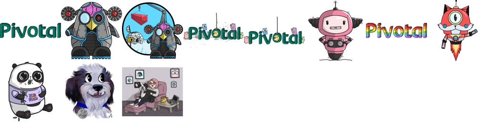

# Readme - Artwork
----------------------
 
## How can you use these things?

Download and unzip the artwork.zip and in there you'll find the PNG files. 
These files are ready to print and I suggest [Sticker Mule](https://www.stickermule.com/) for high-quality, color correct, stickers. 

## Special shout-out to:

* [Jessie Frazelle](https://x.com/jessfraz)
* [Tyler Britten](https://x.com/vmtyler)
* [Ant Stanley](https://x.com/IamStan)
* [Mat Ryer](https://x.com/matryer)

## Software used
The application used to create this artwork is Adobe Illustrator.

## Legal

This work is licensed under a [Creative Commons Attribution-NonCommercial-ShareAlike 4.0 International License](https://creativecommons.org/licenses/by-nc-sa/4.0/).

Please contact me if you wish to use any of this artwork for commercial purposes (anywhere revenue is obtained, including advertising).

## Find me online:

[@ashleymcnamara](https://x.com/ashleymcnamara)

